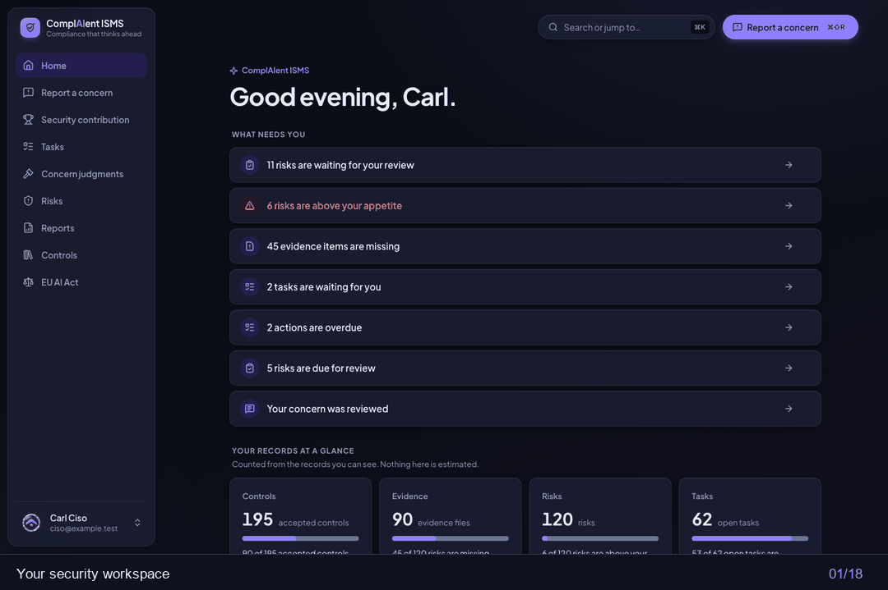

# ComplAIent ISMS

**A source-available, AI-native Information Security Management System for regulated organisations.**
Run risks, controls, evidence and your Statement of Applicability for ISO 27001, NIS2, GDPR and NIST in one place, with an AI assistant that stays in the EU.

> _A sophisticated security system should not require a sophisticated user._

[](https://github.com/timcrouch/ComplAIent/actions/workflows/ci.yml)
[](LICENSE)



<sub>Sample data: a year of activity for a fictional German financial firm. Load it yourself with <code>pnpm demo:load</code>.</sub>

---

## Why ComplAIent

Most GRC tools are built for compliance specialists. ComplAIent is built for everyone else in the organisation as well: people describe a concern in plain words, and the AI turns it into a structured, reviewable ISMS record. The CISO gets records that are complete enough to plan, approve and audit.

- **Plain-language intake.** Anyone can report a concern. The AI asks follow-up questions and drafts the risk; a person always reviews and approves it.
- **Built for auditors.** An append-only audit trail enforced in the database, versioned risks, separation of duties on approvals, and evidence files that are stored once and never overwritten.
- **EU-first AI.** AI calls go through one gateway with EU-only routing and zero data retention required. The provider key is encrypted at rest. Every feature works with AI turned off.
- **One installation per organisation.** No shared multi-tenant database. Each organisation runs its own copy, with its own database and storage.

## Features

| Area                            | What you get                                                                                                                                                                                                                                                                    |
| ------------------------------- | ------------------------------------------------------------------------------------------------------------------------------------------------------------------------------------------------------------------------------------------------------------------------------- |
| **Risk management**             | Concern reporting, AI-assisted risk drafting, scoring against your own risk scale and appetite, review and approval workflow, treatment plans and actions                                                                                                                       |
| **Control library**             | 100 in-house controls mapped to ISO/IEC 27001:2022 Annex A, NIS2, GDPR, NIST CSF 2.0 and NIST SP 800-53 Rev. 5 (Moderate), with AI control suggestions                                                                                                                          |
| **Controls in operation**       | Control tests with evidence, AI-suggested test steps, test due dates                                                                                                                                                                                                            |
| **Evidence**                    | Evidence requests as tasks, SHA-256-hashed files in S3-compatible storage                                                                                                                                                                                                       |
| **Statement of Applicability**  | Applicability decisions per requirement, grouped by framework structure, with status derived from control tests                                                                                                                                                                 |
| **Reports**                     | Risk register and SoA as PDF and XLSX, and a board report with charts and an AI-drafted narrative                                                                                                                                                                               |
| **Access control**              | Roles scoped to the organisation, a site or a department; server-side enforcement; step-up sign-in for sensitive actions                                                                                                                                                        |
| **EU AI Act** (optional module) | An AI system register, risk classification by questionnaire under Regulation (EU) 2024/1689, the obligations of your role (provider, deployer, importer, distributor), linked risks and AI-assisted drafting of answers and steps. Off by default; an administrator turns it on |
| **Demo mode**                   | Load a year of realistic sample data for a fictional German financial firm, and reset it, from the Setup screen                                                                                                                                                                 |

## Quick start

**You need:** Docker Desktop (about 4 GB RAM free), Node 26 via [nvm](https://github.com/nvm-sh/nvm), and pnpm via `corepack enable`.

```sh
git clone https://github.com/timcrouch/ComplAIent.git
cd ComplAIent
nvm use
pnpm install
cp .env.example .env      # local development placeholders only
pnpm run setup            # start Postgres, Redis, MinIO and Keycloak, migrate, load the control library
pnpm dev                  # web app on :3000, API on :4000, worker
```

Open <http://localhost:3000> and sign in as `admin@example.test` with the `DEV_USER_PASSWORD` from your `.env`. The first sign-in becomes the organisation administrator.

**Try it with sample data:** set `DEMO_TOOLS_ENABLED=true` in `.env`, restart `pnpm dev`, then use **Setup → Demo and training → Load sample data**, or run `pnpm demo:load`.

**Turn on AI (optional):** set `AI_SECRETS_KEY` (`openssl rand -base64 32`), then add your [OpenRouter](https://openrouter.ai) key in **Settings → AI assistant**. EU-only routing needs an OpenRouter Business plan; for local experiments see `AI_ALLOW_NON_EU_ROUTING` in [local development](docs/operations/local-development.md).

Full setup, dev users, ports and troubleshooting: [docs/operations/local-development.md](docs/operations/local-development.md).

## Architecture

A modular monolith in a pnpm monorepo, written in TypeScript end to end.

```
apps/
  web/       Next.js 16 + React 19: the UI and a backend-for-frontend that holds the session
  api/       NestJS 12: REST API, authorisation, audit, reports
  worker/    BullMQ jobs: AI suggestions, embeddings, scheduled reviews
packages/
  contracts/        Zod route contracts shared by web and API (and the OpenAPI document)
  database/         Prisma 7 schema and SQL migrations (Postgres 17 + pgvector)
  domain/           Pure business rules: scoring, approval rules, SoA status
  ai/               The AI gateway (OpenRouter, EU routing, structured output)
  control-library/  Framework, requirement and control content, plus the sync
  ui/               The design system (light and dark)
  demo/  jobs/  config/  telemetry/  tooling/
```

- **Sign-in:** OpenID Connect (Keycloak locally; any compliant identity provider). Tokens never reach the browser.
- **Storage:** Postgres for records, S3-compatible object storage (MinIO locally) for evidence files, Redis for sessions and queues.
- **Observability:** OpenTelemetry, Prometheus and Grafana in the local stack.

Design decisions are recorded as ADRs in [docs/decisions](docs/decisions). The [security architecture](docs/security/architecture.md) covers trust boundaries, tokens, authorisation layers, audit immutability, secrets and the OWASP ASVS L2 mapping.

## Testing

```sh
pnpm typecheck && pnpm lint && pnpm test   # static checks and unit tests
pnpm db:migrate:test && pnpm test:integration   # against the local Docker stack
pnpm e2e                                    # Playwright end-to-end tests
```

CI also runs dependency, container and secret scanning (OSV-Scanner, Trivy, gitleaks) on every pull request.

## Framework content and licensing

The control library is written in-house. ISO/IEC 27001 requirements are referenced by number only, with titles in our own words; no ISO text ships. GDPR and NIS2 are EU law. NIST CSF 2.0 and SP 800-53 content is paraphrased from NIST publications, which are credited as the source. Organisations with an ISO licence can import the standard's text into their own installation. See [ADR-0008](docs/decisions/0008-control-library-provenance.md).

## Project status

ComplAIent is in active development and not yet production-ready. The core loop (report a concern, assess and approve a risk, link controls and evidence, test controls, decide applicability, report to the board) works end to end, and so does the optional EU AI Act module. Planned next: email, Slack and Teams notifications, policy management, internal audits and incidents. See the [open issues](https://github.com/timcrouch/ComplAIent/issues).

## Contributing

Issues and pull requests are welcome. Before a larger change, please open an issue to discuss it. Every pull request runs the full CI suite; please add tests with your change.

By submitting a contribution, you agree that Tim Crouch may use, relicense and distribute it under any terms, including commercial ones, and you confirm you have the right to grant this.

## Security

Please do not report vulnerabilities in public issues. Use GitHub's [private vulnerability reporting](https://github.com/timcrouch/ComplAIent/security/advisories/new) instead.

## Licence

ComplAIent is **source-available** under the [PolyForm Shield License 1.0.0](LICENSE).

- **You may** use, modify and share it for any purpose, including running it inside your own organisation, commercially or not.
- **You may not** sell it, or offer a product or service that competes with it (for example, hosting it for others as a paid service).

For commercial licensing, contact Tim Crouch.

Copyright © 2026 Tim Crouch.

---

Created by **Tim Crouch**, [Global Software AI](https://globalsoftware.ai), Riga.
